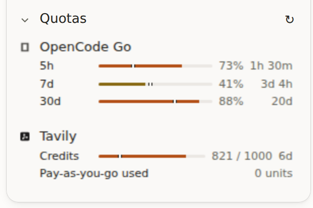
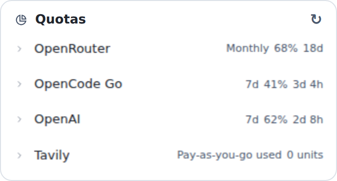
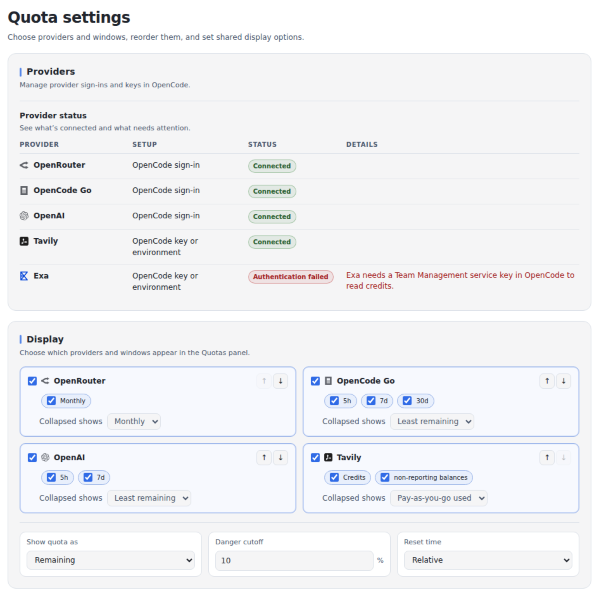

<h1 align="center">Quota Display for OpenChamber</h1>

  

See what you have left, when it resets, and whether you’re on pace—without leaving your OpenChamber session. Expand a provider for detailed bars, or collapse it to the one number you care about.

## Get started

Requires **OpenChamber 2.8.0 or later** on web or desktop. Not available in VS Code.
OpenCode and the OpenChamber server must run on the same machine to refresh OpenCode-backed quotas.

1. Go to **Settings → Extensions → Add extension** and select this folder or a ZIP of it.
2. Approve the local service and OpenCode plugin.
3. Connect your providers in OpenCode CLI
4. Reopen OpenChamber and look for **Quotas** in **Work Status**. If it’s hidden, use **Choose sections**.

## Supported providers

**OpenRouter, OpenCode Go, OpenCode Zen, OpenAI, Tavily, and Exa.**

- OpenAI quota requires a ChatGPT sign-in in OpenCode
- Exa team credits require a Team Management service key, not a regular search key.

## Make it yours

Open **Pages → Quota settings** to show, hide, or reorder providers, pick what each collapsed row shows, and switch between **Remaining** and **Used**. Quotas remembers which providers you collapsed when you reopen OpenChamber. Display settings are shared across windows on the same server. Quotas refresh every five minutes; check **Provider status** in settings if authentication fails.

If several OpenChamber servers run on one machine, set the plugin's `bridgeServerId` option where the OpenCode plugin entry supports options; otherwise the plugin binds only while exactly one bridge is live. Display settings and the last readings persist across restarts. Existing extension data is not wiped automatically, and OpenCode sign-ins are never changed.

[Developer documentation](docs/README.md)

## License and credits

[MIT licensed](LICENSE). See [Credits](CREDITS.md) for acknowledgments and third-party notices.
